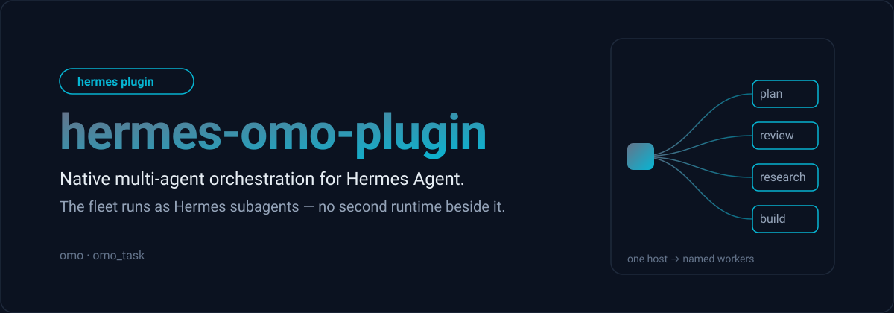

<div align="center">



<!-- SHIELDS_BADGES -->
[](https://github.com/jomakori/hermes-omo-plugin/actions/workflows/ci.yaml)
[](https://github.com/NousResearch/hermes-agent)
[](https://www.python.org)
[](LICENSE)
<!-- /SHIELDS_BADGES -->

</div>

# hermes-omo-plugin

Multi-agent orchestration for [Hermes Agent](https://github.com/NousResearch/hermes-agent): a roster of named specialists — orchestrator, planners, critics, researchers, engineers — run as Hermes subagents through the host's own lifecycle.

Hermes stays the only user-facing identity: workers return structured results, the host speaks. The roster and model are adapted from [oh-my-openagent](#relationship-to-oh-my-openagent) without its runtime — no OpenCode, no Bun, no SDK to install or pin.

## Features

| Feature | What it does |
|---|---|
| **Agent fleet** | 14 specialists and 5 categories, each with a persona and a default model chain |
| **Task graphs** | Dependencies, parallel fan-out, `BLOCKED` on a failed dependency, reconcilers that still run |
| **Owned fallback** | Per-agent chains, cooldown/restore, bounded premium handoff, `hop_history` per dispatch |
| **Review cycles** | `momus` reviews each task; the verdict is `pass`, `problems`, `unparsed` — never silent |
| **Live status** | One message per run, edited in place, showing each worker's model and current tool call |
| **Transcripts** | Append-only JSONL per run, tail-able while it is still live |
| **OMO Runs tab** | `hermes dashboard` shows the run registry and a live worker feed, read-only |
| **Advisory routing** | `jev_ask` returns a probability envelope; shadow mode calibrates before anything routes on it |
| **Durable runs** | Registry survives a gateway restart; `status` and `cancel` reach only your own session |

## Requirements

- [Hermes Agent](https://github.com/NousResearch/hermes-agent) with plugin and subagent-lifecycle support.
- Python 3.11+ — the host's own interpreter; no extra runtime dependencies.
- `delegation.max_spawn_depth` raised above its default, or the tree stays flat and the orchestrator cannot delegate.

Optional: `TYPESAFE_AI_API_KEY` for `jev_ask`, and Discord's **Manage Messages** if the status message should stay pinned.

## Install

```bash
hermes plugins install jomakori/hermes-omo-plugin --enable
```

Or from a clone:

```bash
git clone https://github.com/jomakori/hermes-omo-plugin.git "${HERMES_HOME:-$HOME/.hermes}/plugins/omo"
hermes plugins enable omo
```

Restart Hermes (or the gateway) so the tools and dashboard tab register, then confirm with `hermes plugins list`. Update with `hermes plugins update omo`, remove with `hermes plugins remove omo`.

## Quick start

```json
{"action": "dispatch", "goal": "harden the sync path", "agent": "hephaestus"}
```

Blocks until the run settles; add `background=true` for a `run_id`, then poll with `status`. `omo_task` delegates one subtask by `agent=` or `category=`. Session scoping, the restart contract and the claim boundary are in [`docs/tool-contract.md`](docs/tool-contract.md).

## Configuration

Settings live in `plugins.entries.omo.settings` in the host's `config.yaml`. Model names resolve through the host's provider routing, so use the aliases it already exposes.

| Setting | Default | What it controls |
|---|---|---|
| `enabled_agents` | unset (all) | Restrict the roster to these names |
| `roles` | — | Caller-facing role names → roster entries, e.g. `implementer: hephaestus` |
| `chains` | `roster.py` | Per-agent model chains, primary first |
| `max_parallel` | `4` | Tasks in flight for one graph dispatch |
| `max_review_cycles` | `1` | Reviewer passes per task; `0` disables review |
| `max_attempts_per_agent` | `3` | Failures of one stage by one agent before the engine refuses; `0` off |
| `max_fallback_attempts` | `3` | Hops the chain walk may take |
| `cooldown_seconds` / `restore_primary_after_cooldown` | `30` / `true` | How long a failed primary is skipped |
| `escalation_budget_chars` | `6000` | Goal plus task context the premium hop receives; `0` disables |
| `worker_timeout_seconds` | `1800` | Hard bound on one child |
| `worker_stall_seconds` | `360` | No new message for this long ⇒ stop it; `0` disables |
| `worker_activity_slice_seconds` | `20` | How often the watchdog looks at a child |
| `state_path` / `max_persisted_runs` | `~/.omo/runs.json` / `50` | Where the run registry lives, and how much of it is kept |
| `status_message_enabled` | `true` | The live status message |
| `status_pin_message` | `true` | Pin it while the run is live (needs **Manage Messages**) |
| `status_edit_interval` / `status_phrase_interval` | `2.0` / `3.0` | Edit throttle, phrase rotation |
| `status_move_interval` | `0.0` | `0` edits in place; above `0` re-posts below the conversation |
| `activity_profiles_dir` | `<hermes home>/profiles` | Where the activity line reads tool calls from |

```yaml
plugins:
  entries:
    omo:
      settings:
        roles: {implementer: hephaestus}
        chains:
          sisyphus: ["<provider>/<model>", "<provider>/<fallback>"]
```

Anything omitted falls back to [`roster.py`](roster.py). Jev's settings are in [`docs/jev.md`](docs/jev.md).

## Tools

| Tool | Purpose |
|---|---|
| `omo` | `dispatch` (one task or a whole graph) / `status` / `tree` / `cancel`, scoped to the calling session unless `all_sessions=true` |
| `omo_task` | Delegate one subtask (`agent=`) or spawn a category worker (`category=`) |
| `jev_ask` | Advisory typed-decision classifier; returns a probability envelope and never executes anything ([docs](docs/jev.md)) |

## Fleet

[`roster.py`](roster.py) is the source of truth. Each persona is `agents/<name>.md`, delivered per dispatch and loadable as `skill_view("omo:<name>")`.

| Agent | Role |
|---|---|
| `sisyphus` | Ultraworker |
| `hephaestus` | Deep Agent |
| `prometheus` | Plan Builder |
| `atlas` | Plan Executor |
| `metis` | Plan Consultant |
| `momus` | Plan Critic |
| `oracle` | Architecture / Reasoning |
| `librarian` | Research |
| `explore` | Repository Exploration |
| `multimodal-looker` | Multimodal Analysis |
| `sisyphus-junior` | Specialized Execution Worker |
| `tester` | Test Author |
| `debugger` | Defect Investigator |
| `security` | Security Reviewer |

Categories — `quick`, `deep`, `ultrabrain`, `visual-engineering`, `writing` — spawn the execution worker with a category-specific chain. Roles (`explorer`, `researcher`, `planner`, `implementer`, `tester`, `debugger`, `reviewer`, `security`, `documenter`, `general`) resolve through `ROLE_ALIASES` and the `roles` setting; `documenter` points at the `writing` category and `general` at `quick`, the only route to `sisyphus-junior`.

## Task graphs

```json
{"action": "dispatch", "goal": "harden the sync path", "review": true, "tasks": [
  {"id": "recon",  "agent": "explore",  "prompt": "map how sync works today"},
  {"id": "fix",    "agent": "debugger", "prompt": "fix the race", "depends_on": ["recon"]},
  {"id": "test",   "agent": "tester",   "prompt": "cover the race", "depends_on": ["fix"]},
  {"id": "report", "agent": "sisyphus", "prompt": "report what shipped", "depends_on": ["fix"],
   "runs_on_failure": true}
]}
```

Independent tasks run in parallel under `max_parallel`; a dependent runs only after its dependencies finish and receives their summaries as context. A dependent of a failed task is reported `BLOCKED` and never launched — unless it is marked `runs_on_failure`, because blocking a reconciler would hide the failure from the only task asked to name it.

A graph is rejected before anything runs if ids repeat, a dependency is unknown or points at itself, a cycle exists, or a task carries both `agent` and `category`. A task that closes without a summary or structured payload is reported `FAILED` (`require_worker_summary`, on by default): an empty result is not evidence of work.

**Stalled children are stopped, not waited out.** The engine polls each child's message store every `worker_activity_slice_seconds`; while it keeps writing, nothing happens but a `worker_heartbeat` event. Once the newest message is older than `worker_stall_seconds`, the child is cancelled and the hop fails with `watchdog stopped it: no activity for Ns` — six minutes instead of thirty. No readable store means no liveness signal, and the hard timeout is again the only bound: a watchdog that guessed would kill slow work.

## Review cycles

`"review": true` runs `momus` over each successful task and re-runs it with the reviewer's notes, at most `max_review_cycles` times. A verdict the scheduler cannot parse counts as a pass, so an unreadable review can never cause an infinite rewrite. Reviewer workers appear in the run tree as `<task>:review`.

| `review_verdict` | Meaning |
|---|---|
| `""` | no review ran |
| `pass` | passed, or no problems listed |
| `problems` | re-run with the problems |
| `unparsed` | the reviewer answered in a shape the scheduler could not read |
| `reviewer_failed` | the reviewer never completed |

Only `problems` re-runs a task; the rest are named so "reviewed and clean" is never confused with "the review could not be read".

## Model chains

The host's launch carries `model` only and owns provider routing; per-agent fallback is not native, so it lives in [`orchestrator/chains.py`](orchestrator/chains.py) — a retryable classifier plus a cooldown/restore state machine. A chain is the ordered list of models one agent may be served by, ending at the premium route.

- **Bounded last hop.** `escalation_budget_chars` bounds the goal plus task context sent to the premium model; persona and worker contract travel whole, still inside the host's 32,000-character launch cap. Cheaper hops get exactly the brief the primary got.
- **Bounded attempts.** `max_attempts_per_agent` caps failures of *the same stage* per agent, engine-wide, so a looping stage cannot keep spending. A cancelled attempt does not consume the budget.
- **No re-issue after a disconnect.** A `499` is a hard stop: the walk does not advance, the worker is `cancelled` rather than `failed`, and the payload carries `"client_gone": true` — even if `retry_on_errors` lists `499`.

Every dispatch reports `hop_history` (`{"model", "reason"}` per hop), and `status` carries the same list:

| Reason | Meaning |
|---|---|
| `billing` | drained account: HTTP 402, `insufficient balance`, `add credits` |
| `rate_limit` | 429 or a quota body |
| `transport` | 5xx, timeouts, connection errors |
| `semantic` | non-retryable failures, abort, context overflow |
| `success` | the hop that served the request |

## Live status message

One message per run, never a second, edited in place as the run progresses (a graph run with four workers still owns one message):

```
🏗️ omo · omo_304bf8e5 — shell parity across the fleet · 3 workers

OKT-161 · hephaestus · Deep Agent
- run 🔁 t4 · minimax-m3
  ↳ ✍️ write_file components/shell.rs · ⤵ claude-sonnet-5 (rate limit)
- review ⏳
```

Rows: `🔁` running, `⏳` pending, `✅` done, `🔍` reviewing, `⛔` blocked, `⚠️` interrupted, `❌` failed, `⏸` cancelled. Posted on the first transition, edited under a throttle, pinned while live, unpinned once every worker succeeded. Delivery is best-effort: a failed post, move or edit never fails the run it describes. Render rules, pinning and the event list are in [`docs/status-message.md`](docs/status-message.md).

## Transcripts and dashboard

**Per-run JSONL.** Every run appends to `~/.omo/live/<run_id>.jsonl` — `{seq, ts, agent, task_id, kind, text}`, with `kind` one of `launch` / `status` / `tool` / `result` / `error`:

```bash
tail -f ~/.omo/live/omo_304bf8e5.jsonl
```

The dispatch result names the file (`live_transcripts`, `live_transcript_hint`). Text is redacted and capped at 500 characters, files older than seven days are pruned, and a failed write leaves the run unaffected — see [`docs/live-transcript.md`](docs/live-transcript.md).

**OMO Runs tab.** `/omo` in `hermes dashboard`, over the read-only API in [`dashboard/plugin_api.py`](dashboard/plugin_api.py): the registry on the left, the selected run's workers and live transcript feed on the right. It reads `~/.omo/live` and `~/.omo/runs.json` and writes neither; the feed stops polling when the run goes inactive.

## How it works

Every worker launches through the host's subagent lifecycle, so it inherits the host's session record, event stream, transcripts, tool scoping and provider routing. The plugin supplies what the host does not: the roster, the chains, the graph scheduler, the run tree.

- **Personas are delivered, not assumed.** `agents/<name>.md` goes into the launch `context` behind an authoritative preamble, and is also registered as `skill_view("omo:<name>")` — every definition fits the 32,000-character cap except `sisyphus`, which is truncated with a pointer.
- **No per-agent permission tier.** Hermes derives a child's capabilities from its parent; an earlier read-only tier could not be expressed that way and never fired, so every agent runs with the parent's capabilities.
- **The registry is on disk.** Created, then rewritten at each worker's terminal state; a restart adopts it and reports what it cannot stand behind as `INTERRUPTED`.
- **Workers cannot talk to the user.** The host strips `send_message`, `delegate_task`, `clarify`, `memory` and `cronjob_manage` from child toolsets, so the worker contract states a fact rather than asking for compliance.
- **Registration is unconditional.** `register_tool` fails loudly if missing; `register_command`, `register_skill` and `on_unload` are each attempted on their own, so a host missing one still gets the others.

## Repository layout

```
hermes-omo-plugin/
├── plugin.yaml              # manifest (name: omo, version)
├── __init__.py              # register(ctx): tools, commands, skills, dashboard
├── roster.py                # fleet: agents, categories, default chains
├── agents/                  # one persona per roster entry
├── orchestrator/            # engine, graph, chains, store, status, transcripts
├── omo_tools/               # omo / omo_task / jev_ask handlers
├── jev/                     # typed-decision client, packs, shadow harness
├── dashboard/               # OMO Runs tab: manifest, read-only API, built UI
├── docs/                    # contract, status message, transcripts, audit
└── tests/
```

## Security and data

| Surface | Behaviour |
|---|---|
| Writes | `state_path` (`~/.omo/runs.json`), `~/.omo/live/`, and with shadow on, `~/.omo/jev-shadow.jsonl` |
| Profile reads | `profiles/<agent>/state.db`, to resolve the activity line and detect a stalled child |
| Network | model calls go through the host's routing and credentials; the only direct call is TypeSafe Jev, and only when `jev_ask` is called, shadow is on, or authoritative routing is enabled |
| Credentials | provider keys never touch the plugin; `TYPESAFE_AI_API_KEY` is read from the environment at call time and never logged |
| Chat | the live status message is the plugin's only chat writer; workers have no user channel at all |
| Command authority | workers inherit the parent's toolsets and run non-interactive; dangerous commands are refused by the host's approval path |

No telemetry, no phone-home. The audit of every chat-emitting path during a run is in [`docs/containment-audit.md`](docs/containment-audit.md).

## Limits

- **Pinning is Discord-only** and needs **Manage Messages**; otherwise it degrades to a logged no-op.
- **The activity line is approximate under concurrency** — a worker maps to its agent profile's newest session at launch.
- **No resume.** A restart reports a running worker `INTERRUPTED` and does not continue its work.
- **Worker output is a claim.** `claim_boundary` says what the engine observed and what the worker wrote about itself.
- **The 32,000-character launch cap is the ceiling** for a persona; anything larger is truncated with a pointer.
- **Stall detection needs evidence.** Without a readable store, only the hard timeout bounds a child.

## Troubleshooting

| Symptom | Cause and fix |
|---|---|
| Tree stays flat, orchestrator "cannot delegate" | `delegation.max_spawn_depth` is still at its default — raise it |
| Tools missing after install | the plugin is not in `plugins.enabled`, or Hermes was not restarted |
| An agent is refused | it is not in `enabled_agents`; the error names the enabled ones |
| Status message posts but never pins | the bot lacks **Manage Messages** (403 / 50013, logged and skipped) |
| OMO Runs tab is empty | no run dispatched yet, or `live_transcript_dir` moved the writer off the directory the tab reads |
| `jev_ask` returns `unavailable` | key unset, `jev_enabled: false`, or a timeout; deterministic defaults are returned |

## Documentation

| Document | Covers |
|---|---|
| [`docs/tool-contract.md`](docs/tool-contract.md) | Background dispatch, session scope, claim boundary |
| [`docs/status-message.md`](docs/status-message.md) | Render rules, delivery, pinning, events, activity line |
| [`docs/live-transcript.md`](docs/live-transcript.md) | JSONL shape, kinds, readers, retention |
| [`docs/jev.md`](docs/jev.md) | Packs, envelope, shadow calibration, authoritative routing |
| [`docs/containment-audit.md`](docs/containment-audit.md) | Every chat-emitting path during a run |
| [`docs/omo-slim-mechanism-inventory.md`](docs/omo-slim-mechanism-inventory.md) | Mechanism inventory against pinned upstream behaviour |

## Development

```bash
python3 -m venv .venv && ./.venv/bin/pip install pytest ruff
./.venv/bin/python -m pytest tests -q
./.venv/bin/ruff check . && ./.venv/bin/ruff format --check .
```

CI runs the suite, both ruff gates, and a guard that fails if a persona prompt still carries an unresolved template token.

## Relationship to oh-my-openagent

This plugin is an adaptation of [oh-my-openagent](https://github.com/code-yeongyu/oh-my-openagent) (formerly oh-my-opencode) for Hermes.

- **Reused:** the agent roster, personas, and the category routing model.
- **Replaced:** OMO's runtime coupling — OpenCode, Bun, the `@opencode-ai` SDK, `opencode.json`, its lifecycle hooks and `omo.jsonc`. The host's own plugin, delegation and config primitives stand in.
- **Not affiliated:** an independent, unofficial adaptation, not produced or endorsed by OMO's authors.

## Attribution

The agent roster, personas and categories originate in [oh-my-openagent](https://github.com/code-yeongyu/oh-my-openagent) by code-yeongyu. The persona prompts under `agents/` are ported from it.

**License note:** upstream OMO is **not open source**. It is source-available under the **Sustainable Use License v1.0** (SUL-1.0), which permits use and modification for personal or internal business purposes but restricts commercial use and redistribution. The files under `agents/` therefore remain under that licence and are not relicensed here — see [`THIRD-PARTY-NOTICES.md`](THIRD-PARTY-NOTICES.md).

## License

[MIT](LICENSE) for everything this repository originates. The persona prompts under `agents/` are derived from oh-my-openagent and stay under its licence — see [`THIRD-PARTY-NOTICES.md`](THIRD-PARTY-NOTICES.md).

The plugin version lives in `plugin.yaml`.
